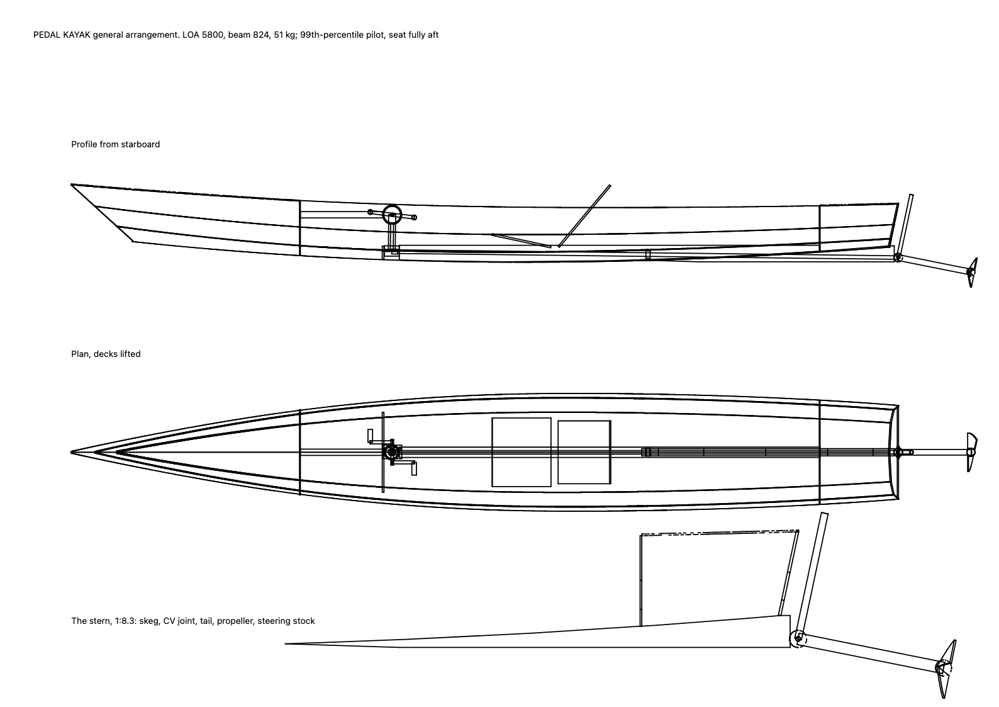
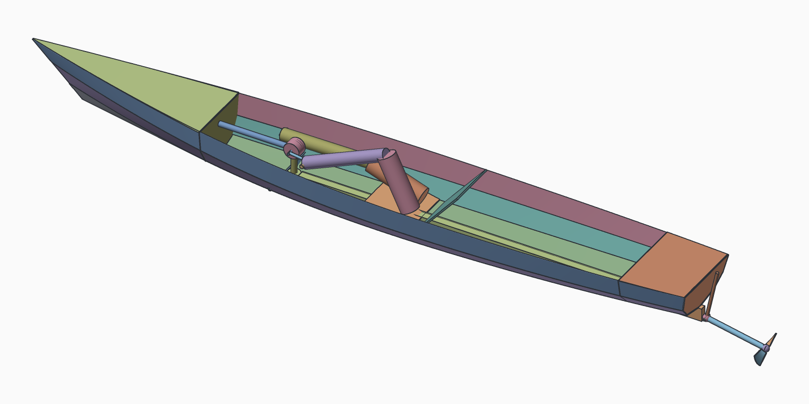
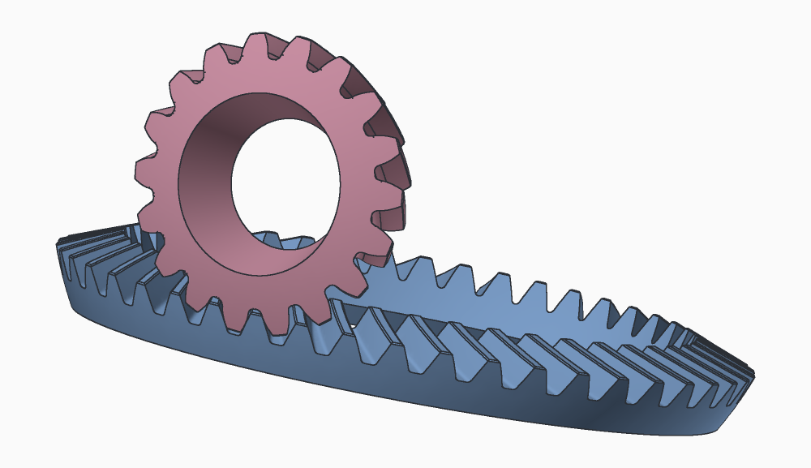
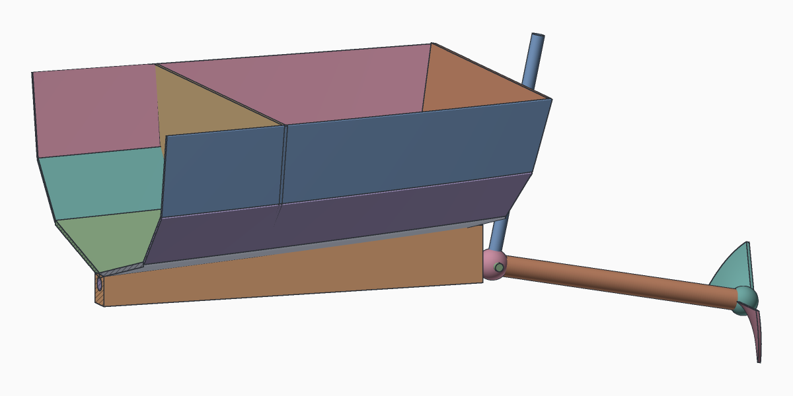

# Pedal kayak

A plywood stitch-and-glue pedal kayak for open water in the San Juan Islands. A recumbent pilot
drives a propeller through two spiral bevel stages and a line shaft that passes through the hull.
The hull follows the Duckling (Sam Devlin's 14′ skiff): six developable plywood panels, three a side,
plus a transom and assorted pieces. Every part is drawn in [Solvent](https://github.com/bmander/geomsolver)
and checked with `solventc` v0.1.24.





## State of the design (v0.3)

Built and solving:

- **Hull.** Seven rails, each in its own plane and convex in it, so every panel develops without
  folding. Six developable strakes, a raked transom, a skeg, two bulkheads, a floor frame under the
  pedal tower, the shaft tunnel, and two developable decks.
- **Cut file.** All six strakes are laid flat (their neutral layers, outside up) on two blanks of
  three scarfed sheets each, one 9 mm and one 6 mm, with the transom pattern on the 9 mm blank.
- **Drive.** Two spiral bevel stages, each laid out and cut by a generating crown (geomsolver's
  `HypoidPair` with no offset):
  - stage 1: 45:18, module 2.5, at the cranks;
  - stage 2: 42:15, module 2, over the keel.

  Also: the pedal tower, the line shaft with its midway bearing, the CV joint, the gimbal (tilt pin
  and raked steering stock), and the hinged tail.
- **Propeller.** A professional-grade design, `tools/propeller.py` → `prop.sv` and
  [`docs/propeller.md`](docs/propeller.md):
  - minimum-induced-loss blades (Adkins & Liebeck), NACA 16 sections on the a = 1.0 mean line,
    with NeuralFoil polars at each station's own Reynolds number;
  - analysed off design by blade-element momentum and matched to the hull and the rider;
  - checked for sprint strength, Goodman fatigue under the tail's crossflow, cavitation and
    strikes, with a shear pin;
  - its math reviewed independently. The review found three defects in the cavitation check and
    the offsets table, now fixed;
  - lofted in solventc from its design table.
- **Seat and pilot.** A sliding recumbent seat. The leg is checked as a two-link chain for the
  1st-percentile woman and the 99th-percentile man of ANSUR II, at the pedal's far and near points.
- **Design table** (`dims.sv`). 20 claims, all holding. Among them: stability, freeboard,
  power against drag, gear root stresses, shaft stress, whirl and wind-up, tail and CV-joint
  angles, propeller clearance when raised, seat travel and seat width.

## Key numbers

| | |
|---|---|
| LOA × beam × depth | 5800 × 824 × 380 mm |
| Boat weight (estimate) | 51 kg: hull 38, drive 9, seat 4 |
| Design load / full load | 156 kg (draft 123 mm) / 320 kg (draft 181 mm, freeboard 199 mm) |
| GM, design / full | 263 / 189 mm |
| Speed (estimate) | 4.41 kn at 100 W (cadence 61 rpm), 4.94 kn at 160 W (the propeller's design point, cadence 70 rpm). Propeller η 0.81 (analysed). 40–250 W gives about 3.4–5.4 kn. |
| Train | 70 rpm at the cranks × 2.5 × 2.8 = 490 rpm at the propeller. Slip 16%; thrust loading C_T 0.20. |
| Propeller | Ø270 mm, 2 blades, left-handed, P/D 1.51 at 0.7 R (the pitch varies along the blade), expanded area ratio 0.13, NAB C95800, 0.90 kg, Ø1.8 mm brass shear pin. Cavitation-free to 250 W at the design load (estimate). |
| Line shaft | 6061-T6 tube, 25 × 1.5 mm, 3.55 m. Whirls at 1258 rpm with the midway bearing, and at 315 rpm (below running speed) without it. Wind-up 2.1° at the cranks under a 200 N·m push. |
| Tail | 520 mm, 11.3° below level when running. CV joint at 10.6° running, 27° at full helm, 33° raised. Deepest point (the guard fin) about 352 mm below the waterline running, ~150 mm with the tail raised. |
| Seat | 380 mm of travel. The hip moves 2967–3303 mm aft of the stem head to fit legs from 921 to 1267 mm (ANSUR II functional leg length). Knee bend at the top of the stroke: 103° (smallest pilot), 89° (largest). |

## Files

| File | What it is |
|---|---|
| `dims.sv` | The design table, every figure with its unit, and the claims it is held to (`solventc dims.sv`). |
| `tools/lines.py` | The lines plan and hydrostatics. `python3 tools/lines.py --write` regenerates the rails, transom, skeg, bulkheads, tunnel and deck rails in `hull.sv`. |
| `hull.sv`, `hull.svd` | The `Hull` component, and the cut file at the top level. Drawing sheets: `lines` and `cutting`. |
| `drive.sv` | The `Drive` component. `drive.sv` itself draws the drive with its teeth cut (`teeth: 1`, about a minute to solve and minutes to render). |
| `tools/propeller.py`, `prop.sv` | The propeller's design, analysis and report (`.venv/bin/python tools/propeller.py --write`, which needs `numpy`, `scipy` and `neuralfoil` in `.venv`), and its geometry: `Propeller`, `Hub`, `BladeSection`, and `propeller` as one part. |
| `docs/propeller.md` | The propeller design report. |
| `findings/` | A solventc behaviour worth reporting, with its reproduction. |
| `seat.sv` | The `Seat` and `Pilot` components; the ergonomics check across the ANSUR range. |
| `kayak.sv`, `kayak.svd` | The assembly, with gear blanks (`teeth: 0`) so it solves in a second. Drawing sheet: `arrangement`. |
| `spiral_bevel/hypoid.sv` | geomsolver's `HypoidPair`, vendored unchanged (MIT). |
| `docs/hinged-tail.html` | The interactive concept sketch of the tail. Its numbers came before this model and differ from the current ones. |
| `renders/` | PNG renders, and the cut file as SVG. |

```sh
solventc dims.sv                                   # the design table: every claim judged
solventc kayak.sv --png kayak.png --view 300,35    # the assembly
solventc hull.svd --sheet cutting -o cutting.svg   # the cut file
solventc drive.sv --png tower.png --view 35,20     # the gears with their teeth (slow)
```





## What solventc did, and where it pushed back

- **Developable panels:** every strake, both decks, and their developments are exact. The rails
  were designed planar and convex so that no panel folds. A pattern placed by its edge can land on
  the reversed root, so the starboard middle strake is laid bow-right on its blank.
- **Spiral bevels:** generated by the crown, with the face mill's pressure shift found where the
  pinion's two flanks are equally far from undercut (stage 1: −1.35°, margin 0.21).
  - Seating a pair with `seats` on rotated datums diverged in this version. Explicit relations
    converge.
  - The cut pairs did not converge inside the full assembly. So the assembly uses blanks of the
    same size, and `drive.sv` carries claims (theorems) that the cut members' mean points coincide
    with the blanks'.
- **The propeller** is a face family along each blade's radial stacking line. Each station is a
  NACA 16 section, built from interpolating splines through 27 points placed by `coords`
  relations, with every number a polynomial in the span fraction.
  - An elliptic tip (infinite chord slope) stopped the exact build, so the tip is parabolic.
  - Fixed planes and `fix` with expressions in `s` are refused inside a family; a station word
    and relations are what work.
- **Rotation.** Working through the train's directions showed that forward pedalling turns the
  line shaft clockwise seen from ahead, so the propeller is left-handed. Moving the crank gear to
  the other side would reverse it, but the cut pair then failed to solve.
- **A sensitivity in the cut pairs' solve.** Whether `drive.sv` with cut teeth converges depends on
  an unrelated solid in the file (`findings/`).
- A deck could not be cut from a longer developable sheet with a half-space. Each deck has its
  own short rails instead.

## Open items

1. Gear webs and hubs, so each gear reaches its shaft. Bearings (`std.bearings`) and seals. The
   housings are placeholders.
2. Choose the bevels' spiral hands for the thrust directions the rotation gives, and check each mesh
   as it rolls (as geomsolver's `shaft_drive/mesh.sv` does). The propeller's hand is settled:
   left-handed.
3. The tail's kick-up stop, its down-spring and raise line, and the tiller and steering cables.
4. Seat rails and the adjuster. A cockpit coaming and spray cover for chop. Flotation volumes.
5. A Michell-integral wave-resistance estimate to replace the 25% allowance. Trim with the pilot
   and passenger placed. Test the propeller's thrust and torque against rpm to anchor its polars.
6. The hull rails are B-splines whose control points are `lines.py`'s offsets, so the rails lie a
   few mm inside them (6 mm at the keel's lowest point). Either interpolate the rails
   (`spline(through: …)`) or compute the hydrostatics on the B-splines.
7. Cut files for the bulkheads, decks, tunnel, skeg and seat.
8. Update the tail sketch (`docs/hinged-tail.html`) to the modelled numbers: the joint is 93 mm
   below the waterline and the tail runs 11° down.
