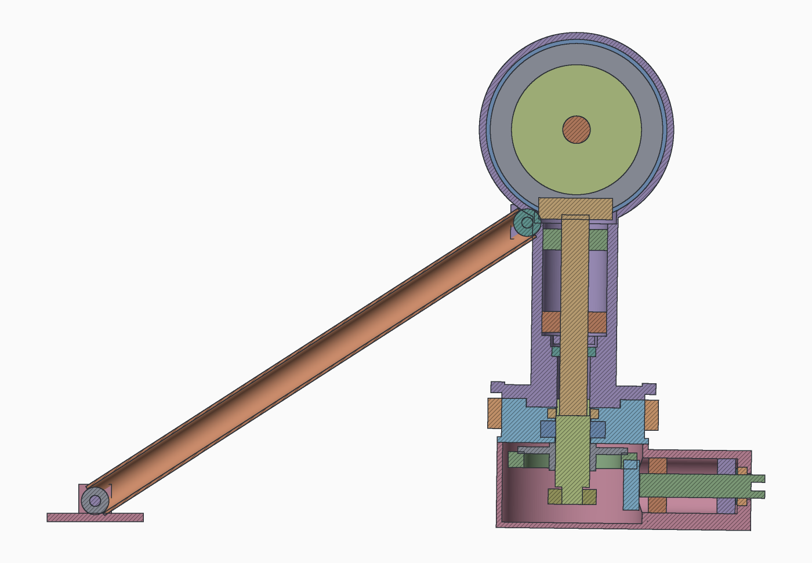
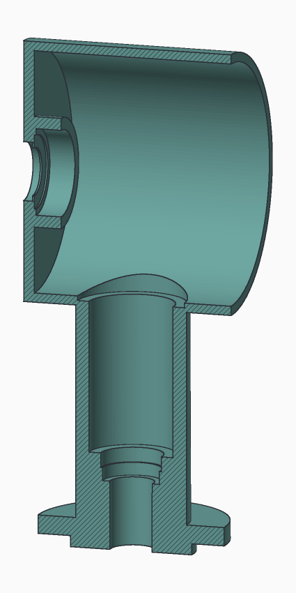
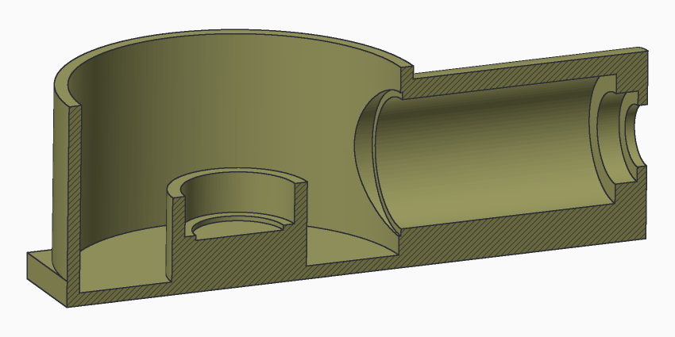
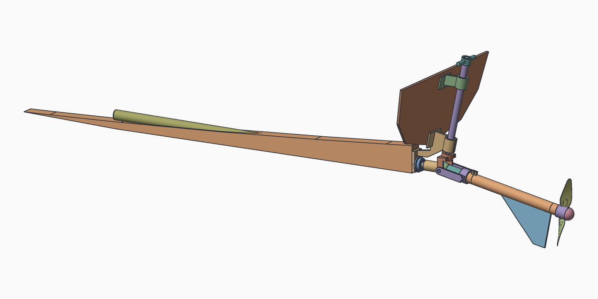
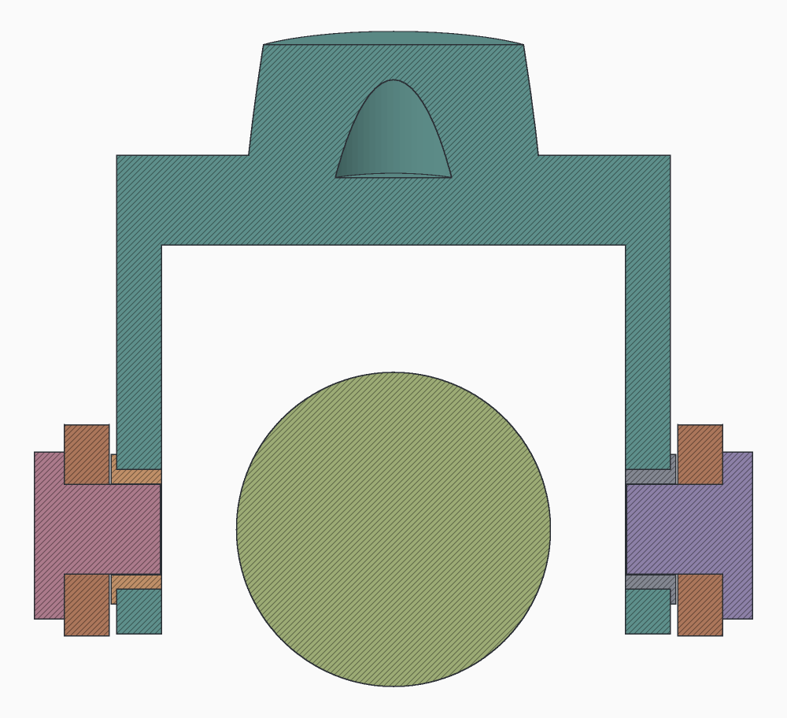
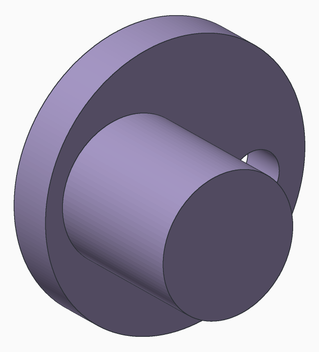

# Mechanical design

The structure that carries the drive, the gearboxes, the line shaft's route through the hull, the
heel, the gimbal and the tail. The numbers and checks are in [`mech.sv`](../mech.sv) (`solventc
mech.sv`: 28 claims). The parts are drawn in [`drive_parts.sv`](../drive_parts.sv),
and the hull's share of the structure in [`hull.sv`](../hull.sv).

The parts are drawn to be made in a small machine shop: a CNC mill, a manual mill, a lathe and a
welder.
- **CNC-milled from 6061-T6 billet, then hard anodised:** the housings, the heel bracket, the
  gimbal fork and the tail's head.
- **Turned:** shafts, plugs and pins. 4140 (quenched and tempered) inside the gearboxes; 316 or
  17-4PH where a part meets the sea.
- **Welded, then their bores finished:** the strut, the upper steering bracket and the yoke.
- **Bought:** the rest (see [the bought-in parts](#bought-in-parts)).



## Load paths

The design case is the sprint: the cranks' peak of 200 N·m, one leg pushing 1290 N off the seat
back from a standing start.

- **The pedal's push goes forward and stays inside a closed loop.**
  - The push enters the crank axle.
  - From the axle it goes into the upper box, then into the strut (1530 N of compression at
    32.7°), then into the drive bed.
  - The bed runs aft along the keel seam to the tunnel.
  - The tunnel is a box girder of 9 mm webs, and the seat's rails are on it. The seat back's
    reaction comes back along the rails.

  The hull's planking carries neither force; it only takes the glue lines' shear (0.04 MPa on
  the bed).
- **The vertical share** of the strut's force lifts the tower off the keel box. Two draw latches
  hold it down, at 900 N between them. Each is rated 1.5 kN.
- **The torque** goes through the train:
  - 200 N·m at the cranks;
  - 80 N·m in the tower;
  - 28.6 N·m in the line shaft.

  The step-up comes before the long shaft, so the line shaft's torque and wind-up stay small.
  Wind-up is 2.1° at the cranks.

## The route through the hull

| x (aft of the stem head) | what the drive passes |
|---|---|
| 1900 | the strut's clevis, on the drive bed (pin at z 60) |
| 2160 | the floor frame, 12 mm, notched over the drive bed |
| 2192–2387 | the keel box, bolted to the drive bed (z 45) |
| 2390 | the tunnel begins; the line shaft's tang leaves the keel box's output |
| 4044 | the midway bush, on the tunnel's floor (the lid over it lifts off) |
| 4380 | the stern tube begins, inside the tunnel |
| 4400–5130 | the stern tube passes out through the keel seam; the garboards are cut back round it and glassed to it inside and out |
| 5250 | the aft bulkhead (the tube passes beneath it, in the skeg) |
| 5670 | the skeg's heel: the heel bracket, the shaft's bearing, the seal cartridge |
| 5798 | the joint: the centre of the double U-joint, at the intersection of the tilt and steering axes |
| 6308 | the propeller, 520 mm down the tail at 11.3° |

The line shaft runs dry from the keel box to the heel cartridge. The cartridge's outer lip seal
is the only place water meets the drive. It sits 150 mm under the full-load waterline, a head of
1.5 kPa, which a lip seal holds easily. You can reach it from outside with the boat on its cart.

### Taking the shaft out

1. Support the tail, remove the M4 keeper screw on each ear and draw both pins outboard. Slide the double U-joint off the stub.
2. Unbolt the seal cartridge from the heel bracket.
3. Draw the shaft aft. The stub's 6004 comes out of its seat with it, and the shaft's forward
   tang slides out of the keel box's slot.

The shaft passes the midway bush and the stern tube because nothing on it is wider than the tube:
25 mm, against the stern tube's 32 mm bore. Nothing inside the hull has to be opened.

## The tower (lifts out)

The tower is the upper box on its neck, with the strut.

To lift it out:
1. Pull the ball-lock pin at the strut's foot.
2. Open the two draw latches.
3. Lift the tower straight up. The neck's spigot leaves the keel box's recess (Ø68.6, 6 deep), and
   the tower pinion's tang leaves the slot in the tower gear's stub.

It goes back in the same way. Turn the cranks a little to line the tang up with the slot.

### Upper box: stage 1 (45:18, module 2.5)

- **Drum.** Ø141 round the crank gear: the gear's tip at 62.7 mm, 3 clear, a 5 mm wall. The drum
  is closed to port. A bolted cover closes it to starboard, and the gear goes in that way.
- **Crank axle.**
  - 4140, Ø20, on two 6204-2RS bearings 94 apart.
  - A JIS square taper at each end (2° per flat, 15 long) takes stock 155 mm cranks. Gauge the
    flats to the cranks you buy: JIS D 9410 is the reference.
  - Lip seals (20 × 32 × 5) in both end walls.
  - The sprint load on the near bearing is 4.3 kN against a C0 of 6.55 kN.
  - The axle's von Mises stress at the bearing is 248 MPa, with a yield of 655 MPa.
- **Crank gear.** Its ring is the cut member, with a web behind its heel and a hub keyed to the
  axle, located against the starboard bearing.
- **Tower pinion.**
  - Cut on its own shaft, 4140 carburised.
  - Overhung on two 30204 tapered rollers mounted back to back, 60 apart, set by a nut with shims
    under the cone. The overhang is 24.
  - The shaft runs on down the neck to a 20 × 6 tang that drives the keel box.
  - Bearing A carries 5.3 kN radial plus 2.1 kN thrust at the sprint, against a C0 of 28 kN.
- **Neck and flange.**
  - The neck is Ø62. Its flange is Ø104, with two latch keepers fore and aft.
  - Two lugs under the drum take the strut's top eye on an Ø8 pin.

### Keel box: stage 2 (42:15, module 2), fixed

- **Chamber.** Ø110 round the tower gear. Its floor is a flange with four M8 studs into the drive
  bed. Its lid carries the gear's upper bearing and the spigot recess. The latch bodies stand on
  the lid's boss.
- **Tower gear: straddled.**
  - Upper bearing: a 6005-2RS in the lid, under a 25 × 37 × 7 seal.
  - Lower bearing: a 6202-2RS in a boss rising from the floor.
  - The line pinion's toe stands 37 mm aft of the tower's axis, so the lower boss clears it.
  - The stub's top is slotted for the tower's tang: 6.2 wide, 12 deep.
- **Line pinion.**
  - Cut on its own shaft, overhung on two 30203 back to back, 50 apart.
  - Its end is slotted for the line shaft's 16 × 6 tang.
- Both boxes are filled with semi-fluid grease (NLGI 00), so they don't leak when the boat is
  stored on end.

### Gearbox pocket machining

| Upper housing through the crank axle | Keel housing along the line shaft |
|---|---|
|  |  |

The STEP solids use boat coordinates. Use each pair's shaft intersection as the origin for the local machining coordinates below. The two pockets below leave integral bearing bosses. Dimensions and fits apply after coating. Mask the finished seats or allow finishing stock before anodising.

| Housing | Machining sequence and inspection |
|---|---|
| [Upper](../fabrication/upper_housing.step) | Enter through the open starboard cover face. Rough the drum cavity to y = −39, then pocket around a Ø60 island to y = −54. Bore the island Ø47 H7, 14 deep to y = −53, for the 6204. The shoulder has a Ø40 relief 1 deep. From the port face at y = −60, bore the Ø32 H8 seal seat 5 deep, with a Ø26 through passage. The port seal and bearing install from opposite sides. |
| [Keel](../fabrication/keel_housing.step) | Enter through the lid face. Pocket around a Ø43 island up to its top at z = −2, leaving the chamber floor at z = −28. Bore Ø35 H7 from the island top to z = −14.5 for the 6202. The Ø28 relief continues 1.5 below the seat. The 8-thick mounting foot overlaps the aft barrel by 2 at its lowest point. |

Check each bearing against its maker's abutment and corner-radius limits. Trial-seat the outer race against the shoulder and check free inner-ring rotation. Indicate the port seat against the assembled cover bearing axis and the lower keel seat against the lid bearing axis. Cover registration, fasteners, shims and final alignment tolerances are still open.

### Setting the meshes

Each pair is set the way a differential is.
- Shim the pinion's cone to its mounting distance.
- Shim the gear's bearing to the backlash: 0.06 mm normal for stage 1, 0.05 for stage 2.
- Check the contact pattern with marking compound.

### Spiral hands

Both pairs speed the shaft up: the gear drives the pinion. For a driven member, thrust runs along
its turning vector if it is left-handed. Forward pedalling turns both pinions about vectors that
point away from their apexes. So both pinions are **left-handed** and both gears right-handed.
- Each pinion's thrust then pushes it out of mesh under drive: 2.07 kN and 1.09 kN at the sprint.
- Backpedalling reverses the spiral's share. The tapered pairs locate both ways.
- `spiral_bevel/hypoid.sv` cuts a fixed hand. Check the cut members' hands against this before
  tooling (open item).

## The line shaft

- **Tube.** 6061-T6, 25 × 1.5, hard anodised so the midway bush can run on it.
- **Plugs.** Each is bonded 40 mm into the tube and cross-pinned. The bond's shear is 0.94 MPa.
  - Forward: 17-4PH, with a tang 16 wide and 6 thick, bearing 45 MPa on its flanks.
  - Aft: 316. It runs on as the Ø20 stub through the heel cartridge into the U-joint.
- **Midway bush.** Acetal, 25 × 35 × 30, in a block on four rubber mounts on the tunnel's floor.
  Pinned there, the shaft whirls at 1258 rpm. It runs at 490.
- **Stern tube.** GRP, 32 × 38, laid in a channel routed in the skeg's top. Its clearance is 3.5
  mm against a 0.7 mm sag over the 1.78 m span.
- **Heel cartridge.**
  - The 6004-2RS seats in the heel bracket's plate.
  - The cartridge carries two 20 × 35 × 7 FKM lip seals: the inner lip turned in to hold the
    grease, the outer turned out to keep the sea out, with grease packed between them.

## The heel, gimbal and steering



- **Heel bracket.** One CNC part.
  - A 12 mm plate on the skeg's heel, on four M8 studs set in epoxy. It seats the shaft's bearing.
  - A 10 mm knee web, bedded under the hull's bottom.
  - A plate on the transom's aft face, through-bolted, with a 9 mm okoumé pad inside.
  - The stock's lower boss at the web's aft end.
- **Steering stock.**
  - 316 tube, 25 × 3, raked 12° with the transom and 76 mm off it, through the joint.
  - It turns in two acetal-bushed bosses: the lower on the heel bracket (z 100–150), the upper on
    a welded bracket near the transom's top (z 350–395).
  - A 200 N side load at the propeller, at full helm, bends it to 37 MPa.
- **Gimbal fork.**
  - Clamped to the stock's foot, the two fork arms straddle the joint. Each arm carries a flanged bush, with its flange against the adjacent tail ear. A short Ø12 pin enters from the outside of each ear. An eccentric flange on the pin takes an M4 keeper screw into the ear.
- **Double U-joint.**
  - A Ruland UD24-20MM-15MM-SS: stainless, 38 OD, 167 long, rated 147 N·m, with its boot.
  - The joint centre lies on the tilt and steering axes. Constant-velocity operation depends on equal articulation angles and correct yoke phasing. Check both with the purchased joint.
  - Its angles are 10.6° running, 27° at full helm and 33° raised.
- **Tail.**
  - The head is milled: a collar, a bar, and two ears.
  - The tube is 6061-T6, 40 × 2, hard anodised.
  - Two acetal bushes carry the Ø15 316 propeller shaft.
  - A lug on the tube takes the raise line.
  - A 6 mm 316 guard fin under the tube reaches 25 below the blades' tips, ending forward of
    their sweep.
- **Controls.**
  - A yoke on the stock's head takes two Ø1.5 stainless pull-pull cables, in conduit, to a lever
    beside the seat.
  - The raise line runs up inside the hollow stock, so steering doesn't wind it, to a cleat by the
    seat.
  - A spring detent on the fork holds the tail down and lets go to a strike at 40 N·m about the
    pin, as a kick-up rudder does.
- **Thrust.** The thrust acts along the tail through the tilt axis, so it neither holds the tail down nor
  lifts it. The detent and the tail's weight hold it down.

### Tail pivot machining and inspection

| Transverse section through the joint centre | Removable pivot pin, journal side |
|---|---|
|  |  |

The round centre body represents the joint envelope at the pivot. The pin tips are 62.4 apart and each clears that Ø42 body by 10.2.

Dimensions are in mm. The joint centre is the tilt-axis datum. The pin rotates with the tail ear. Use the pin flange underside as the axial machining datum and the journal axis for the eccentric features. The left and right pins are interchangeable, as are the two bushes.

| Part | Qty | Prototype machining dimensions |
|---|---:|---|
| [Pin](../fabrication/tilt_pin.step), 316 stainless | 2 | Journal Ø12 g6 (11.983–11.994) × 12.80 ±0.05 long, Ra ≤0.8 µm. Flange Ø24 × 4.00 ±0.05, centre offset 4.50 ±0.05 aft. Drill Ø4.5 through at 12.00 ±0.05 aft of the journal on the same centreline. Radius the journal root 0.2 max and break the tip edge 0.2 × 45°. Passivate after machining. |
| [Fork](../fabrication/gimbal_fork.step), 6061-T6 | 1 | Finish both Ø16 H7 bush seats on one axis after coating. Across the outer arm faces 74.00 ±0.05. Arm thickness 6.00 ±0.05. |
| [Flanged bush](../fabrication/tilt_bush.step), bearing-grade acetal | 2 | Turn the sleeve to 0.015–0.035 interference on the **measured** fork bore. Sleeve length 6.00 +0/−0.05, flange Ø20 × 0.75 ±0.03. Press from outboard. Line-finish the installed bores to Ø12.10–12.15. The STEP gives the installed nominal shape. |
| [Tail head](../fabrication/tail_head.step), 6061-T6 | 1 | Finish both Ø12 H7 pin bores on one axis. Inside width 76.00 ±0.05, ear thickness 6.00 ±0.05. Chamfer the outboard mouths 0.3 × 45° for the pin root. Drill Ø3.3 and tap M4 × 0.7 through each ear, 12.00 ±0.05 aft of the journal on the tail centre-height line. Mask the threads during anodising. |
| Keeper screw, ISO 4762, A4 stainless | 2 | M4 × 10, one per pin. Use removable locking compound compatible with the finish and marine exposure. Verify the screw seats its flange and clears the fork over travel. |

With the bushes installed, pass a straight Ø12.08 gauge through both bores together. Check the aligned ear bores with a straight Ø11.995 gauge. The nominal total side play is 0.50. The two widths and two flange tolerances allow 0.34–0.66. With both keepers tight, measure that travel with an indicator and check that both pins withdraw while the tail is supported. With the purchased boot installed, turn the shaft through a full revolution at running depth, full helm both ways, and through kick-up. Check for rubbing and binding at combined helm and tilt.

The design's 200 N transverse tip load at 520 mm gives a 104 N·m yaw moment. Two opposing pin reactions spaced 68 mm apart carry 1.53 kN each. For a 7 mm lever the journal stress estimate is 70.4 MPa von Mises, against 205 MPa yield for annealed 316. Projected bush pressure is 22.0 MPa over 5.8 mm engagement. Confirm the selected acetal grade's wet intermittent-load rating and check wear, creep and keeper retention on the prototype. The calculation covers the specified static load. Impact and fatigue life need test data.

The detail views can be regenerated from the repository root with solventc v0.1.28.

```sh
solventc tilt_detail.sv \
  --png renders/tilt_section.png --view right --section x=5798mm --size 1000 \
  --png renders/tilt_pin.png --solid starboard_pin --view 234,24 --size 720
solventc drive_parts.sv \
  --png renders/upper_bearing_pocket.png --solid mechanism.upper_box.housing --section x=2250mm --view 18,12 --size 850 \
  --png renders/keel_bearing_pocket.png --solid mechanism.keel_box.housing --section y=0mm --view 247,18 --size 850
```

## The hull's share

- **Drive bed.** Laminated ash, 60 wide, from x 1860 to 2390, its top at z 45. Glued and glassed
  on the keel seam; it passes through a notch in the floor frame.
- **Tunnel.** 9 mm webs with 60 clear between them, from x 2390 to the aft bulkhead. The lid is
  9 mm and screws down in sections; the section over the midway bush lifts for access.
- **Seat rails.** Two 20 × 20 aluminium rails on the webs' outsides. The carriage locks with an
  Ø8 pin through holes 20 apart, 19 stations over the travel.
- **Seat height.** The hip is now 240 above the keel, up from 200, so the seat pan clears the
  tunnel by 22 mm. The design GM drops to 240 mm, still above its 150 mm floor. The leg checks
  still hold: knee bend 103° for the smallest pilot and 89° for the largest.
- **Skeg.** Its heel moved forward to x 5670 to make room for the heel bracket and the U-joint's
  forward half.

## Clearances

[`fit.sv`](../fit.sv) claims, in solventc, that each pair of parts that must not touch is clear by
a margin. Building every solid takes about three minutes. The gear blanks it checks are each cut
member's true envelope: toe tip to heel back, at the tip radius. The results:
- the gears 3–4 mm from their housings, by design. The drum's bore is the crank gear's tip plus 3,
  and pockets clear the tower pinion and the line pinion where they enter their necks;
- the shaft 3.5 mm inside the stern tube and 17 mm from the tunnel;
- the bush block 1.8 mm inside the tunnel's webs;
- the keel box 4.9 mm off the garboards;
- the strut 86 mm over the floor frame;
- the seat pan 22 mm over the tunnel;
- the cranks 2 mm from the drum and cover;
- the gimbal fork 2.8 mm from the heel bracket, and the tail's ears 1 mm from the fork.

The heel bracket's transom plate is bedded 3.5 mm off the transom's face, so it clears the
planking's ends there; those ends are trimmed flush when the boat is built.

## Bought-in parts

| part | qty | where |
|---|---|---|
| 6204-2RS (20 × 47 × 14) | 2 | crank axle |
| 30204 tapered roller (20 × 47 × 15.25) | 2 | tower pinion |
| 6005-2RS (25 × 47 × 12) | 1 | tower gear, upper |
| 6202-2RS (15 × 35 × 11) | 1 | tower gear, lower |
| 30203 tapered roller (17 × 40 × 13.25) | 2 | line pinion |
| 6004-2RS stainless (20 × 42 × 12) | 1 | heel |
| lip seals: 20 × 32 × 5 (2), 20 × 32 × 7, 25 × 37 × 7, 17 × 28 × 7, 20 × 35 × 7 FKM (2) | 7 | boxes, heel |
| Ruland UD24-20MM-15MM-SS double U-joint, with boot | 1 | joint |
| stainless draw latch, ≥ 1.5 kN | 2 | tower |
| Ø8 ball-lock pin, 316 | 1 | strut's foot |
| JIS square-taper cranks, 155 mm, and pedals | 1 set | |
| acetal bushes: 25 × 35 × 30, stock 25 × 30 (2), tail 15 × 36 (2) | 5 | |
| GRP tube 32 × 38, 1.3 m | 1 | stern tube |
| 6061-T6 tube 25 × 1.5 (3.4 m), 25 × 2, 40 × 2; 316 tube 25 × 3 | | shafts, strut, tail, stock |
| Ø1.5 stainless cable, conduit, lever | | steering |

## Open items

1. **Spiral hands.** Make the cut members left-handed pinions and right-handed gears, then check
   each mesh as it rolls.
2. **Detail drawings** of each machined part, with fits:
   - bearings: k5 on the shaft, H7 in the housing;
   - tapered cups: N7 in the housing;
   - seals: H8 in the housing;
   - plus each part's bolt patterns. The models give the geometry. The drawings still need the
     fits, chamfers, thread callouts and tolerances.
3. The keys and keyways, the nuts' threads and lock washers, and the shim packs.
4. The kick-up detent's cam and spring, the steering lever and its conduit's run, and the raise
   line's sheaves.
5. The gears' manufacture. A 3-axis CNC mill cannot cut spiral bevels. Either a gear shop cuts
   them from these models, or they come off a 5-axis machine, and are then case-hardened and
   lapped in pairs.
6. Detail the heel seal cartridge before wet testing. The existing cartridge solid overlaps the Ø35 seal envelopes. It needs accessible seal counterbores, a static seal against the bracket and a fastening pattern.
